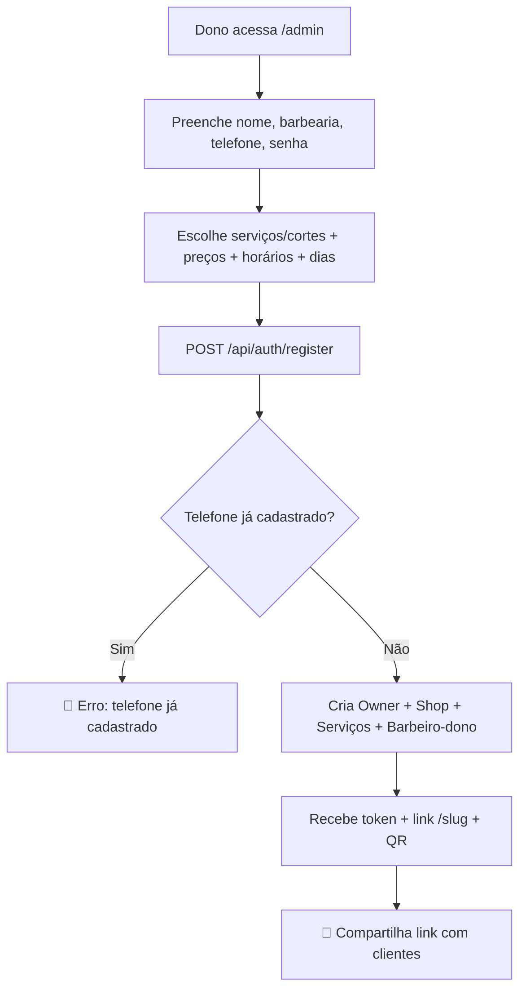
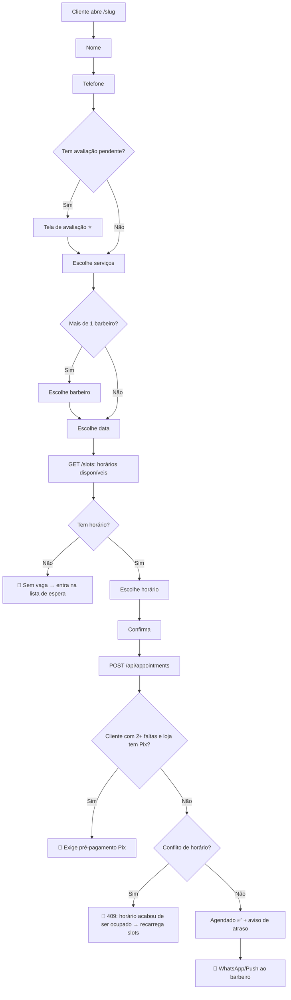
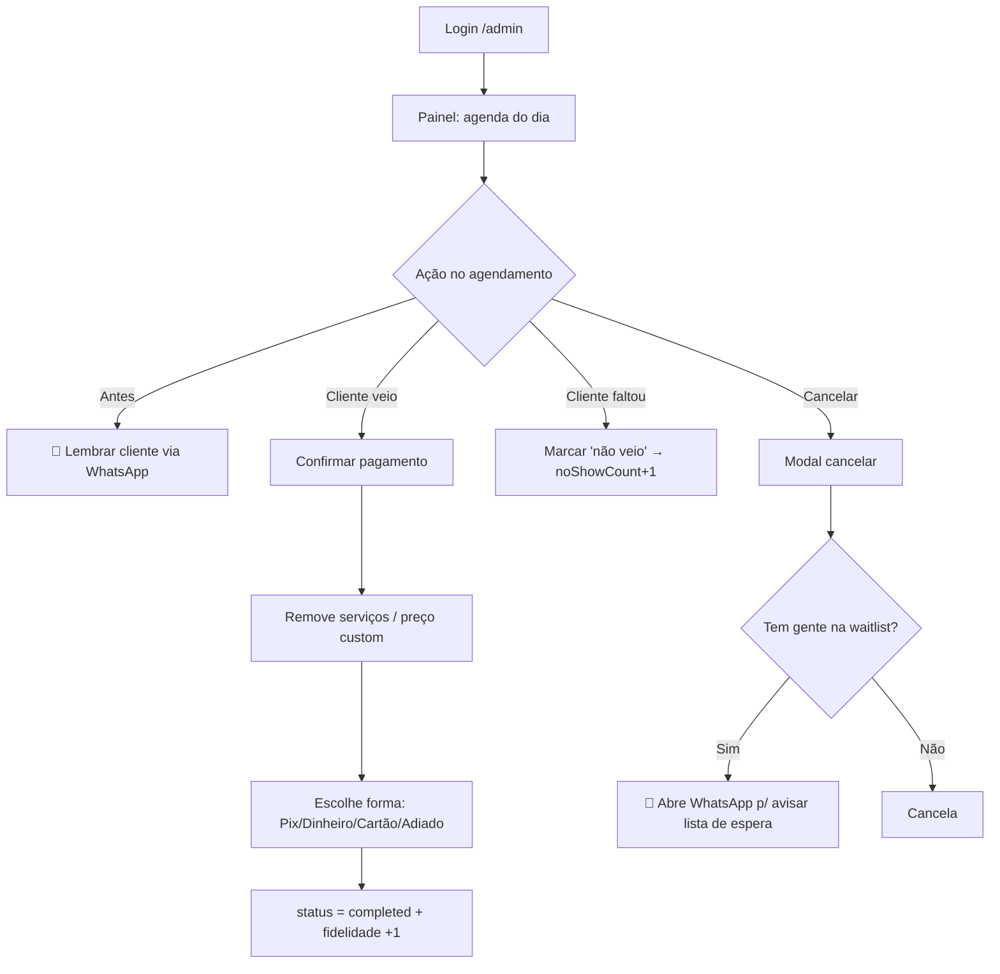
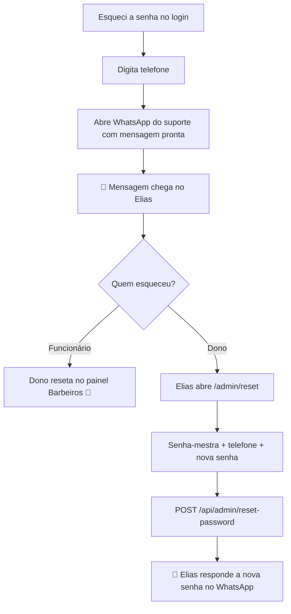
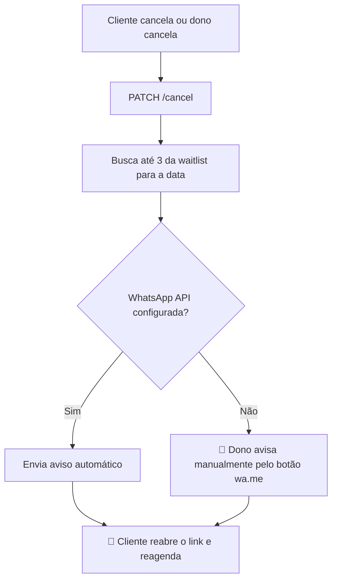

# 05 — Jornadas e Fluxos

> Fluxos ponta a ponta extraídos do código. 🔴 = ponto de fricção · 🤝 = handoff entre atores.

---

## Jornada 1 — Onboarding do dono

`[CONFIRMADO: admin/page.tsx, register/route.ts:30-79]`

---

## Jornada 2 — Cliente agenda (fluxo por etapas)

`[CONFIRMADO: [slug]/page.tsx, appointments/route.ts, slots/route.ts]`

---

## Jornada 3 — Dia de trabalho do barbeiro

`[CONFIRMADO: painel/page.tsx, finance/route.ts, cancel/route.ts]`

---

## Jornada 4 — Recuperação de senha

`[CONFIRMADO: admin/page.tsx, admin/reset, add-barber PATCH — sessão]`
🔴 **Fricção:** o reset do **dono** depende de intervenção humana do Elias (não é self-service).

---

## Jornada 5 — Vaga aberta → lista de espera

`[CONFIRMADO: cancel/route.ts, painel — sessão]`
🔴 **Fricção:** não há reserva automática da vaga — o cliente da fila precisa correr para reagendar antes de outro.

---

## Handoffs críticos (resumo)

| Handoff | De → Para | Canal | Risco |
|---------|-----------|-------|-------|
| Link de agendamento | Dono → Cliente | WhatsApp/QR | Baixo |
| Novo agendamento | Sistema → Barbeiro | WhatsApp/Push | **Médio** (API instável) |
| Vaga aberta | Sistema → Waitlist | WhatsApp | **Médio** (manual hoje) |
| Reset de senha do dono | Cliente → Elias → Cliente | WhatsApp | **Alto** (100% manual) |
