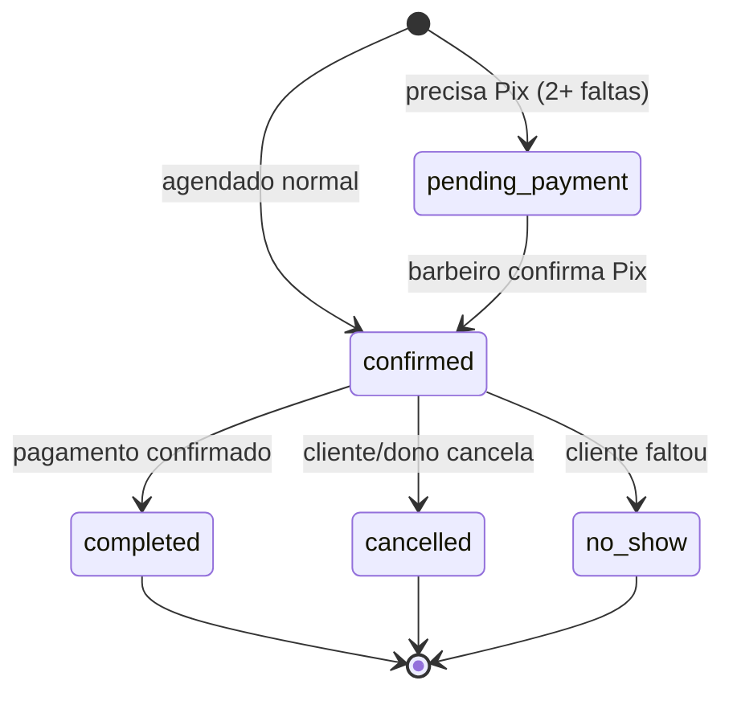

# 08 — Modelo de Dados

> Extraído de `web/prisma/schema.prisma`. 13 entidades. IDs `cuid()`, monetários `Float`,
> soft-delete via `active` onde aplicável. `[CONFIRMADO: schema.prisma]`

---

## Diagrama ER

```mermaid
erDiagram
  Owner ||--o{ Shop : possui
  Shop ||--o{ Barber : tem
  Shop ||--o{ Service : oferece
  Shop ||--o{ Product : vende
  Shop ||--o{ Appointment : recebe
  Shop ||--o{ LoyaltyCount : controla
  Shop ||--o{ BlockedSlot : bloqueia
  Shop ||--o{ Waitlist : mantem
  Barber ||--o{ Appointment : atende
  Barber ||--o{ BlockedSlot : define
  Client ||--o{ Appointment : faz
  Client ||--o{ LoyaltyCount : acumula
  Client ||--o{ Rating : escreve
  Appointment ||--o{ AppointmentService : contem
  Appointment ||--o{ ComandaItem : consome
  Appointment ||--o| Rating : gera
  Service ||--o{ AppointmentService : compoe
  Product ||--o{ ComandaItem : entra

  Owner { string id PK; string name; string phone UK; string passwordHash }
  Shop { string id PK; string ownerId FK; string name; string slug UK; string openTime; string closeTime; int[] workDays; int avgServiceTime; string pixKey; string logoUrl; string colorTheme; string bookingMode }
  Barber { string id PK; string shopId FK; string name; string phone; string passwordHash; bool active; string role; bool isOwnerProfile; string pushToken; float commission }
  Service { string id PK; string shopId FK; string name; int duration; float price; string category; string imageUrl; bool active }
  Product { string id PK; string shopId FK; string name; float price; string imageUrl; bool active }
  Client { string id PK; string name; string phone UK; string email; int noShowCount; string notes }
  Appointment { string id PK; string shopId FK; string barberId FK; string clientId FK; datetime date; string startTime; string endTime; int totalDuration; float totalPrice; string status; string paymentMethod; datetime paidAt; datetime deferredPaymentDate; datetime reminderSentAt; datetime cancelledAt; string cancelledBy; bool pixRequested }
  AppointmentService { string id PK; string appointmentId FK; string serviceId FK }
  Rating { string id PK; string appointmentId UK; string clientId FK; string shopId FK; string barberId FK; int score; string comment }
  ComandaItem { string id PK; string appointmentId FK; string productId FK; int quantity; float price }
  BlockedSlot { string id PK; string barberId FK; string shopId FK; datetime date; string time }
  Waitlist { string id PK; string shopId FK; string clientName; string clientPhone; string barberId FK; string[] serviceIds; string preferredDate }
  LoyaltyCount { string id PK; string shopId FK; string clientId FK; string barberId; int count; datetime lastRewardAt }
```

---

## Ciclo de vida dos registros-chave

### Appointment (status)

`[CONFIRMADO: appointments/route.ts, finance, cancel, no-show, confirm-payment]`

### Client
- Criado no 1º agendamento (por telefone). `noShowCount` sobe a cada falta; zera quando o
  barbeiro confirma o Pix pré-pago. É **global** (atravessa barbearias). `[CONFIRMADO: appointments, confirm-payment]`

### Shop
- Criado no registro do dono; guarda configuração (horários, Pix, tema, logo, modo booking).
  Exclusão em cascata dos filhos. `[CONFIRMADO: schema.prisma:40, onDelete: Cascade]`

---

## Glossário de domínio (vocabulário do negócio)

| Termo | Significado no BarberPro |
|-------|--------------------------|
| **Owner / Dono** | Titular da barbearia; também é barbeiro (`isOwnerProfile`). |
| **Barber / Barbeiro** | Profissional que atende; tem comissão. |
| **Shop / Barbearia** | Estabelecimento, identificado por `slug` no link. |
| **Slug** | Parte da URL que identifica a barbearia (`/henrbarber`). |
| **Client / Cliente** | Quem agenda; identificado por telefone, sem senha. |
| **Appointment / Agendamento** | Reserva de horário com 1+ serviços e 1 barbeiro. |
| **Service / Serviço** | Item do catálogo (corte, barba…) com duração e preço. |
| **Comanda / ComandaItem** | Produtos vendidos durante o atendimento (soma ao caixa). |
| **No-show / Falta** | Cliente não compareceu; contado por cliente. |
| **Waitlist / Lista de espera** | Fila para dias cheios; avisada em cancelamento. |
| **LoyaltyCount / Fidelidade** | Pontos por atendimento pago (10 = 1 recompensa). |
| **BlockedSlot / Bloqueio** | Horário/dia indisponível para um barbeiro. |
| **Rating / Avaliação** | Nota 1-5 + comentário, uma por atendimento. |
| **maxSlots** | Capacidade diária estimada = (fechamento-abertura)/tempo médio. |
| **bookingMode** | `steps` (etapas) ou `agent` (chat/IA, desativado). |
| **commission** | % do barbeiro sobre serviços, usada no relatório. |

## Observações de modelagem

- Monetários são `Float` — risco de arredondamento. Padrão de mercado seria `Decimal`. `[CONFIRMADO: schema — ver ADR-006]`
- `Waitlist.serviceIds` é array de strings (não FK) — não garante integridade referencial. `[CONFIRMADO: schema.prisma:221]`
- `LoyaltyCount.barberId` é string livre (não FK forte). `[CONFIRMADO: schema.prisma:236]`
