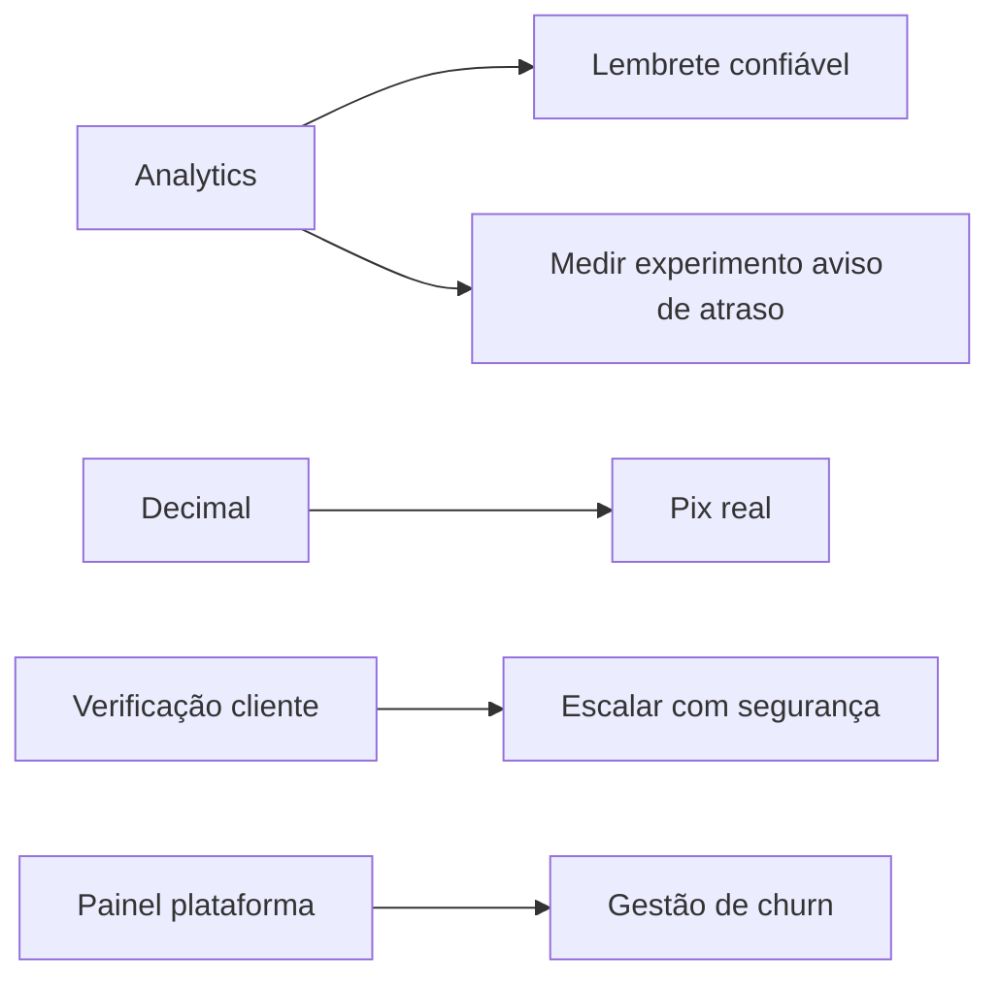

# 12 — Roadmap e Backlog

> Priorização por **RICE** = (Reach × Impact × Confidence) / Effort.
> Escalas: Reach (quantos afeta, 1-10) · Impact (0,25/0,5/1/2/3) · Confidence (%) · Effort (pessoa-semana).
> Todos os scores são **estimativas de PO** `[INFERIDO]`, para debate — não são verdade absoluta.

---

## Backlog priorizado (RICE)

| Item | R | I | C | E | RICE | Justificativa |
|------|---|---|---|---|------|---------------|
| B1 — Confiabilidade do lembrete (SMS pago ou cron pago) | 9 | 2 | 70% | 1 | **12,6** | Ataca R1 (faltas), a dor central; hoje só manual |
| B2 — Verificação do cliente por telefone (código WhatsApp) antes de listar | 8 | 2 | 70% | 1,5 | **7,5** | Fecha risco LGPD/privacidade (R3) |
| B3 — Migrar dinheiro para `Decimal` | 10 | 1 | 90% | 1 | **9,0** | Confiança no financeiro (R2); afeta todos |
| B4 — Pix real (Mercado Pago) p/ pré-pagamento | 7 | 2 | 60% | 2 | **4,2** | Torna anti-no-show efetivo + sinal (R8) |
| B5 — Corrigir limite diário (considerar duração real) | 8 | 1 | 70% | 0,5 | **11,2** | Evita agenda fechar errado; baixo esforço |
| B6 — Self-service de reset de senha do dono | 6 | 1 | 80% | 1 | **4,8** | Tira gargalo do Elias (R7) |
| B7 — Reserva temporária de vaga p/ waitlist | 6 | 1 | 60% | 1,5 | **2,4** | Reduz frustração da fila (RN-027) |
| B8 — Painel agregado da plataforma (visão do Elias) | 3 | 2 | 70% | 2 | **2,1** | Elias enxerga churn/ativação |
| B9 — Instrumentar analytics (conversão do link) | 8 | 1 | 60% | 1 | **4,8** | Habilita decisões por dado (ver doc 10) |
| B10 — Remover/concluir modo chat IA | 5 | 0,5 | 80% | 0,5 | **4,0** | Limpa dívida/escopo (R9) |
| B11 — Atualizar CLAUDE.md | 4 | 0,5 | 90% | 0,25 | **7,2** | Barato; evita erro de novos no time |
| B12 — Publicar no Google Play (R$ 125) | 6 | 2 | 60% | 1,5 | **4,8** | Canal/credibilidade; custo único baixo |
| B13 — Relatório de comissões dedicado | 5 | 1 | 70% | 1 | **3,5** | Valor para donos com equipe |
| B14 — **Billing/assinatura** (planos, cobrança, gate por plano) | 10 | 3 | 70% | 3 | **7,0** | O modelo é assinatura (P2), mas **não existe cobrança no produto** — sem isso não há receita recorrente ao escalar |
| B15 — Expiração de 12h do pré-agendamento Pix | 7 | 1 | 80% | 1 | **5,6** | Regra desejada (P6): sem confirmação em 12h, o pré-agendado some e libera a agenda |
| B16 — Preferência do cliente comum sobre lista negra no mesmo horário | 6 | 2 | 60% | 2 | **3,6** | Regra desejada (P6): inverter a lógica atual (hoje o pré-agendado trava o slot); comum tem prioridade e o da lista negra é avisado ao pagar |
| B17 — Excluir dados do cliente (LGPD, painel do dono) | 8 | 2 | 80% | 0,5 | **25,6** | Direito ao esquecimento (P9/P4); quick win de baixo esforço e alto valor legal |
| B18 — **Taxa de ocupação da agenda** | 9 | 2 | 80% | 0,5 | **28,8** | O KPI mais importante de barbearia e o dono não tem: se está em 50% o problema é divulgação, se está em 95% ele pode subir o preço. Sai de dados que já existem |
| B19 — **Radar de cliente sumido** | 9 | 3 | 70% | 1 | **18,9** | "O Zé vinha a cada 21 dias, faz 48 que não aparece" + botão de chamar. Recuperar cliente antigo é muito mais barato que conquistar novo |
| B23 — Código de recuperação por WhatsApp (OTP) | 8 | 2 | 80% | 1 | **12,8** | Fluxo padrão de mercado: pede código, recebe no WhatsApp, cria nova senha. Depende do token permanente da Meta |
| B20 — Horário morto (sugestão de promoção) | 7 | 2 | 60% | 1 | **8,4** | Transforma cadeira vazia em dinheiro. **Decisão adiada ao barbeiro** — ele avalia se quer |
| B21 — Rendimento por hora de cada serviço | 6 | 1 | 70% | 0,5 | **8,4** | Mostra que R$35 em 30min rende mais que R$80 em 60min. Ninguém faz essa conta. *Guardado para depois* |
| B22 — Tempo real vs estimado do serviço | 6 | 2 | 60% | 1 | **7,2** | "Seus degradês levam 41min mas a agenda reserva 30 — por isso você atrasa." Ataca o atraso na raiz. *Guardado para depois* |
| B24 — Previsão de faturamento do mês | 5 | 1 | 70% | 0,5 | **7,0** | Deixa o dono reagir no dia 15, não descobrir no dia 30. *Guardado para depois* |

> Nota: RICE serve para **ordenar conversa**, não para decidir sozinho. B3/B5/B11 são
> "quick wins" (esforço baixo, confiança alta) e provavelmente vêm antes mesmo com RICE médio.

---

## Decisões de produto registradas (Elias, 25/08/2026)

- **Inteligência de agenda:** B18 (ocupação) e B19 (cliente sumido) **aprovados** para estudo e
  implementação. B20 (horário morto) fica **na mão do barbeiro** — ele decide se quer. B21, B22
  e B24 ficam guardados no backlog, boas ideias mas não agora.
- **Pix:** seguir **só com Mercado Pago**, modelo OAuth ("conectar conta"). Quem não tiver conta
  cria (é grátis); quem não quiser continua no Pix manual. Nubank não tem API pública de
  recebimento para lojista; Inter tem, mas exige certificado — ficam fora por ora.
- **Reset de senha:** manter o código de recuperação como **plano B** e implementar o fluxo
  padrão de mercado (código enviado por WhatsApp) como caminho principal — B23.

## Roadmap em 3 horizontes

> **Marco de negócio (P3):** app 100% pronto e testado até **dezembro**; **lançamento comercial
> em janeiro**. O horizonte "Agora" existe para chegar em janeiro sem risco legal nem bug crítico.

### 🟢 Agora (até dezembro) — pronto para lançar em janeiro
- **B2 (privacidade do cliente)** e **B17 (excluir dados)** — fechar risco LGPD **antes** de
  comercializar (P8/P9). Inegociáveis para o lançamento.
- B3 (Decimal), B5 (limite diário), B11 (CLAUDE.md) — quick wins de confiança.
- B1 (lembrete confiável) — decisão: SMS pago barato vs. manter manual.
- Revisar `/termos` e `/privacidade` (papéis controladora/operador — P4).
- B15/B16 (regras do pré-pagamento Pix — P6) se o amigo barbeiro considerar essencial para o piloto.

### 🟡 Próximo (1–3 meses) — monetização e escala
- **B14 (billing/assinatura)** — pré-requisito de receita recorrente; começar assim que o
  piloto indicar que o modelo cola. Sem isso, "escalar" não vira faturamento.
- B4 (Pix real) — se a venda pedir sinal de verdade.
- B6 (reset self-service), B9 (analytics), B12 (Google Play).
- B8 (painel do Elias) para medir churn/ativação.

### 🔵 Depois (3+ meses) — expansão
- B7 (reserva de vaga), B13 (comissões), multi-barbearia por dono, agenda semanal visual,
  publicação Apple. `[itens também listados como "pendentes" no CLAUDE.md:427-438]`

---

## Dependências e sequenciamento

`[INFERIDO]` — B9 (analytics) destrava decisões baseadas em dado; B3 antes de B4 (dinheiro correto antes de cobrar de verdade).
